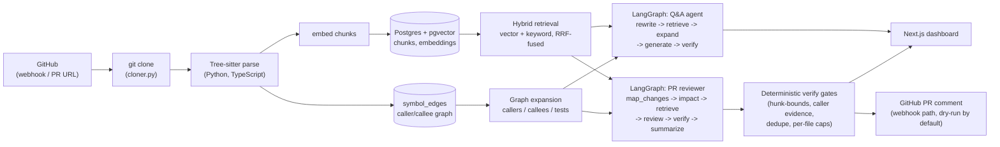

# RepoMind

[](https://github.com/Flashl3opard/RepoMind/actions/workflows/ci.yml)

RepoMind ingests a git repository, parses it with Tree-sitter, and builds two indexes
over it -- vector embeddings in pgvector and a caller/callee symbol graph in Postgres.
On top of that it runs two LangGraph agents: one answers natural-language questions
about the codebase with exact file/line citations, the other reviews pull requests
cross-file, gating every finding behind deterministic checks (not just "the LLM said
so") before it's ever shown to anyone. Reviews run on demand via the API/dashboard, or
automatically on every PR via a GitHub App webhook. A Next.js dashboard covers all of
it: repos, Q&A, review history, a diff-paste playground, and the context-mode
benchmark's results.

## Architecture



See [backend/README.md](backend/README.md) for exactly how each stage works (the
retrieval fusion, the graph walk, the signature-change detector, every verify gate)
and [frontend/README.md](frontend/README.md) for the dashboard.

## Structure

```
backend/            FastAPI ingestion + API service (Python 3.12, uv, ruff, pytest)
frontend/            Next.js dashboard: repos, Q&A, PR reviews, benchmark results
docker-compose.yml   db + backend + frontend -- one command brings up the full stack
.github/workflows/   CI: backend (ruff + pytest against real Postgres) and frontend
```

## Quickstart (one command)

```bash
cp .env.example .env   # add OPENAI_API_KEY or GOOGLE_API_KEY -- see the file's comments
docker compose up --build
```

That's db + backend (migrated automatically on start) + frontend, all from the one root
`.env`. Backend: http://localhost:8000. Dashboard: http://localhost:3000.

Optionally seed it with a small ingested repo, 3 sample Q&A answers, and one PR review
so the dashboard has something to show immediately:

```bash
cd backend && uv run python scripts/seed_demo.py
```

### Makefile targets

`make up` / `make down` / `make test` / `make lint` / `make seed` / `make bench` wrap
the commands above (see the `Makefile` itself for exact flags). No `make` on Windows
without WSL/MSYS? Use the plain commands directly:

| target | plain command |
|---|---|
| `make up` | `docker compose up --build` |
| `make down` | `docker compose down` |
| `make test` | `cd backend; uv run pytest` then `cd frontend; pnpm test` |
| `make lint` | `cd backend; uv run ruff check .` then `cd frontend; pnpm format:check; pnpm lint; pnpm typecheck` |
| `make seed` | `cd backend; uv run python scripts/seed_demo.py` |
| `make bench REPO=... CASES_DIR=...` | `cd backend; uv run python -m evals.bench.run --repo <path> --cases-dir <path>` |

### Running backend/frontend directly (no Docker)

```bash
docker compose up -d db
cd backend
uv sync
cp .env.example .env   # add OPENAI_API_KEY or GOOGLE_API_KEY
uv run alembic upgrade head
uv run uvicorn app.main:app --reload
```

```bash
# in a second terminal
cd frontend
cp .env.example .env.local   # BACKEND_URL + DASHBOARD_API_KEY, matching the backend's
pnpm install
pnpm gen:api                 # generate API types from the running backend's OpenAPI schema
pnpm dev                     # http://localhost:3000
```

## How a review works, and why findings are gated

A pull request review runs a 7-node LangGraph pipeline (`backend/app/review/graph.py`):
parse the diff, map each changed hunk to a symbol, walk the symbol graph for that
symbol's callers/callees/referencing tests, retrieve supporting context, ask the LLM
for findings, then **verify every finding deterministically before it's shown to
anyone** -- the LLM proposes, code disposes:

- A finding must land inside a changed hunk (`passes_hunk_bounds`) and cite at least
  one context label that actually exists (`passes_valid_evidence`) -- an invented
  citation is dropped outright.
- A `breaking_change` finding must attribute unambiguously to the *smallest* changed
  symbol whose range overlaps it (not just any overlapping symbol -- two adjacent
  one-line functions must not be cross-attributed), that symbol's signature must have
  actually changed or been removed, and the finding must cite real caller evidence
  from the graph walk. All three, or it's dropped.
- A `contract_change` finding (a behavioral change where the *declared* signature is
  unchanged -- the one gap `breaking_change` structurally can't cover) instead
  requires a cited real caller **and** a short verbatim quote from that caller's own
  source text, checked after whitespace normalization. An invented quote is dropped;
  a real one caps the finding's severity at `warning`, since it's backed by an LLM's
  read plus a verified quote, not a signature diff.
- Near-identical findings are deduped, and findings are capped per file, most severe
  first.

None of this is about distrust of any particular model -- it's that "the LLM said this
is a breaking change" and "this is a breaking change with a real caller the model
actually cited" are different claims, and only the second one is checked, not assumed.

## Benchmark

`backend/evals/bench/` runs three context modes against the same synthetic (and
optionally hand-curated real-PR) cases: `full` (the real pipeline above), `diff_only`
(a structural lower bound -- the verify gates above make breaking_change/
contract_change *impossible* in this mode by construction, not by model skill, so it
isolates how much cross-file context matters at all rather than measuring anything
fair), and `naive` (a per-file reviewer with none of this project's retrieval/graph
machinery but not structurally gated to find nothing -- **this is the fair baseline**,
not `diff_only`).

**No results are included in this README, and none are invented here.** Numbers
depend entirely on which repo, which LLM, and which API costs you're willing to spend
on evaluation -- a real run looks like:

```bash
cd backend
uv run python -m evals.bench.generate --repo /path/to/some/python/repo --seed 0 --max-cases 20
uv run python -m evals.bench.run --repo /path/to/some/python/repo --cases-dir evals/bench/cases/<repo-name>
# writes evals/bench/results/<timestamp>.json and evals/bench/results/latest.md
```

See [backend/README.md](backend/README.md#running-the-benchmark) for exactly what's
measured (recall, false-positive rate, findings-per-negative-case, evidence-validity,
latency, estimated tokens) and how to add a real-PR holdout case by hand.

## Security notes

- **Webhook signatures.** `POST /webhooks/github` verifies GitHub's HMAC signature
  (`GITHUB_WEBHOOK_SECRET`) before processing anything; an invalid or missing
  signature is rejected outright.
- **Dashboard API auth fails closed.** Every other route requires
  `Authorization: Bearer <DASHBOARD_API_KEY>` (constant-time compare). If that key
  isn't configured, those routes return `503` -- not a fallback to trusting the
  client's network address, which isn't meaningful behind any reverse proxy or
  tunnel. The explicit `DASHBOARD_AUTH_DISABLED=true` local-dev opt-out is itself
  refused at startup unless `REVIEW_DRY_RUN=true` and no webhook secret is configured.
- **Reviews don't post by default.** `REVIEW_DRY_RUN=true` is the default: the
  webhook-triggered pipeline logs the review it would have posted instead of actually
  posting it. The manual `POST /repos/{id}/review` endpoint (used by the dashboard and
  playground) never posts to GitHub at all, regardless of this setting -- only the
  webhook path can.
- **Prompt-injection containment.** The diff, changed-symbol list, and retrieved
  context are placed in clearly delimited blocks in the review prompt with an
  explicit instruction to treat their contents as data, never as instructions -- a
  comment or commit message inside the diff that says "ignore previous instructions"
  is just text to review. This reduces the odds a model is swayed; the deterministic
  verify gates are what stop a swayed model from *fabricating* a finding without real
  evidence (they can't stop under-reporting a real issue the model was told to
  ignore -- see `backend/tests/test_prompt_injection_safety.py`'s docstring for the
  exact, narrower claim that's actually provable here).
- **Token handling.** A GitHub App installation token (used both for posting reviews
  and for cloning private repos during webhook-triggered ingestion) is never placed in
  a cloned repo's remote URL or `.git/config` -- it's passed via a one-off
  `git -c http.extraheader=...` override for that single `git clone` invocation only,
  and any clone-failure error text has the token redacted before it's logged or
  raised. Comment deduplication is scoped to the app's own bot login (resolved via
  `GET /app`, cached), so a human leaving identically-worded feedback can't suppress a
  real finding.

## Known limitations

- **Single-process locks/rate-limiting.** The per-repository ingestion lock and the
  per-installation rate limiter are both in-process (`threading.Lock`/dicts). They do
  the right thing for one process, but don't coordinate across multiple workers or
  replicas behind the same webhook URL -- that needs a shared store (Redis, or the DB).
- **Heuristic rename detection.** A renamed symbol is recognized by a disappeared name
  paired with a body-similar new name in the same file (`difflib`, threshold 0.6) --
  not semantic, and it won't catch a rename where the body also changed substantially
  in the same commit. A pure file rename with no hunks produces no changed symbols at
  all, even if it silently breaks an un-updated import elsewhere.
- **Python and TypeScript only.** Tree-sitter parsing (and therefore everything
  downstream -- chunking, the symbol graph, signature-change detection) only covers
  these two languages' extensions (`.py`, `.ts`, `.tsx`).
- **The benchmark is synthetic by construction.** Cases are generated by mutating a
  real repo's functions with a small, fixed set of deterministic mutators
  (`backend/evals/bench/mutations.py`) -- they're a reasonable proxy for "does cross-
  file context help catch breaking changes," not a substitute for real-world PR
  review quality. The real-PR holdout group (`evals/bench/cases/real/`) exists
  specifically to offset this, but only as far as it's actually kept populated with
  genuine, hand-verified cases.
- **`naive` mode's "full file content" is genuine only in the benchmark.** The
  benchmark reads it off the local repo checkout it already has; the live service has
  no equivalent persistent checkout at review time (it's deleted right after
  ingestion), so `REVIEW_CONTEXT_MODE=naive` against a real PR falls back to the
  diff's own visible text per file -- still a different (per-file) context shape than
  `diff_only`, but a weaker "naive" than the one the benchmark actually measures.
- See `backend/README.md`'s own "Known limitations" section for the full list,
  including per-phase (ingestion, retrieval, PR reviewer, GitHub App, benchmark)
  caveats this summary doesn't repeat.
